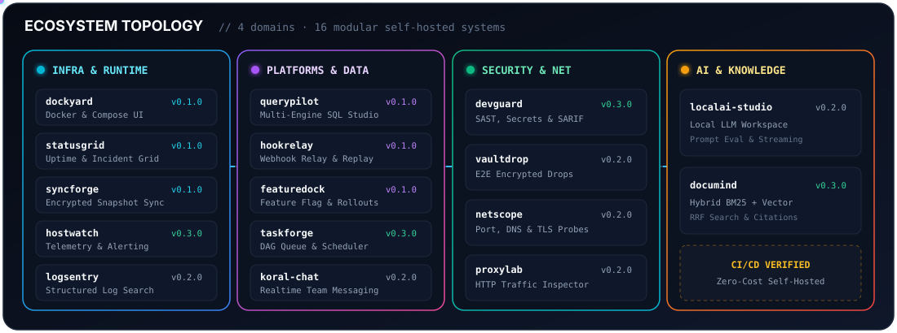

<div align="center">

<!-- Animated Waving Header -->


<!-- Animated Typing Sub-headline -->
<a href="https://github.com/fully-ai?tab=repositories">
  
</a>

<br/>

<!-- Live Identity & Ecosystem Badges -->
<p>
  
  
  
  
  
</p>

<br/>

<!-- Custom Animated Command Center Hero SVG -->


</div>

<br/>

<div align="center">
  
</div>

## ⚡ Core Engineering Stack & Toolchain

<div align="center">

<a href="https://skillicons.dev">
  
</a>

<br/><br/>

<table>
  <tr>
    <td align="center" width="25%">
      <b>🔧 Systems &amp; Control Planes</b><br/>
      <sub>Go · Rust · WebSockets · Unix Sockets</sub>
    </td>
    <td align="center" width="25%">
      <b>🌐 Full-Stack &amp; Dashboards</b><br/>
      <sub>TypeScript · React · FastAPI · SSE</sub>
    </td>
    <td align="center" width="25%">
      <b>🗄️ Storage &amp; Search</b><br/>
      <sub>SQLite WAL · Postgres · BM25 · HNSW/RRF</sub>
    </td>
    <td align="center" width="25%">
      <b>🛡️ AppSec &amp; Delivery</b><br/>
      <sub>SAST · SARIF · HMAC · Ed25519 · Docker</sub>
    </td>
  </tr>
</table>

</div>

<div align="center">
  
</div>

## 🗺️ Live Ecosystem Topology

<div align="center">
  
</div>

<div align="center">
  
</div>

## 🚀 Featured Flagships & Production Systems

### 🐳 Infrastructure, Containers & Observability

| System | Release | CI | Stack | Capabilities |
| :--- | :---: | :---: | :---: | :--- |
| [**dockyard**](https://github.com/fully-ai/dockyard) |  |  | `Go` `React` | Self-hosted Docker & Compose control plane, live stats SSE, stack lifecycle & RBAC |
| [**statusgrid**](https://github.com/fully-ai/statusgrid) |  |  | `Go` `React` | Multi-region HTTP/TCP/DNS probe scheduler, SLA percentiles & public incident boards |
| [**syncforge**](https://github.com/fully-ai/syncforge) |  |  | `Rust` | Content-addressed chunking, Zstd compression, AES-GCM encrypted snapshots & drift diff |
| [**hostwatch**](https://github.com/fully-ai/hostwatch) |  |  | `Go` | Multi-host telemetry, ring buffers, Prometheus `/metrics` & rule alert engine |
| [**logsentry**](https://github.com/fully-ai/logsentry) |  |  | `Go` `React` | Structured JSON/syslog ingestion, FTS search & live streaming tail UI |

---

### ⚙️ Developer Platforms & Data Pipelines

| System | Release | CI | Stack | Capabilities |
| :--- | :---: | :---: | :---: | :--- |
| [**querypilot**](https://github.com/fully-ai/querypilot) |  |  | `Python` `TypeScript` | Multi-engine SQL studio (SQLite/Postgres/DuckDB), schema browser & EXPLAIN visualizer |
| [**hookrelay**](https://github.com/fully-ai/hookrelay) |  |  | `Python` `React` | Inbound webhook gateway, HMAC verification, dead-letter queue & deterministic replay |
| [**featuredock**](https://github.com/fully-ai/featuredock) |  |  | `TypeScript` `React` | Self-hosted feature flags, MurmurHash3 sticky rollouts, rules & SDK evaluator |
| [**taskforge**](https://github.com/fully-ai/taskforge) |  |  | `Python` | Persistent DAG workflow orchestrator, topological scheduler, cron & worker leasing |
| [**koral-chat**](https://github.com/fully-ai/koral-chat) |  |  | `TypeScript` | Lightweight self-hosted team messaging server with channels & WebSocket transport |

---

### 🔐 Security, Cryptography & Networking

| System | Release | CI | Stack | Capabilities |
| :--- | :---: | :---: | :---: | :--- |
| [**devguard**](https://github.com/fully-ai/devguard) |  |  | `Python` | Python AST taint + multi-language SAST, Shannon-entropy secret scanner & SARIF 2.1.0 |
| [**vaultdrop**](https://github.com/fully-ai/vaultdrop) |  |  | `Python` | Zero-knowledge expiring secret & file sharing with client-side cryptography |
| [**netscope**](https://github.com/fully-ai/netscope) |  |  | `Rust` | High-speed network diagnostics, port inspection, DNS lookups & TLS certificate probes |
| [**proxylab**](https://github.com/fully-ai/proxylab) |  |  | `Python` | Programmable HTTP/HTTPS debugging proxy with request capture & replay controls |

---

### 🧠 Local AI & Knowledge Systems

| System | Release | CI | Stack | Capabilities |
| :--- | :---: | :---: | :---: | :--- |
| [**localai-studio**](https://github.com/fully-ai/localai-studio) |  |  | `Python` `React` | Unified workspace for local inference backends, prompt evaluation & streaming chat |
| [**documind**](https://github.com/fully-ai/documind) |  |  | `Python` | Hybrid BM25 + semantic TF-IDF search fused via Reciprocal Rank Fusion & citations |

<br/>

<details>
<summary><b>🧬 Interactive Engineering Matrix &amp; Architecture Highlights (Click to Expand)</b></summary>

<br/>

```text
+-----------------------------------------------------------------------------------+
| fully-ai Engineering Principles                                                   |
+-----------------------------------------------------------------------------------+
| 1. Self-Hosted First     -> Single-binary / Docker Compose ready, zero SaaS lock  |
| 2. Verifiable Security   -> Audited with devguard AST SAST + entropy secret scan  |
| 3. Deterministic Testing -> Reproducible unit & integration suites in GitHub CI   |
| 4. Polyglot Precision    -> Go (infra), Rust (CLI/sync), TS (UI), Python (AI/API) |
+-----------------------------------------------------------------------------------+
```

- **Quick Security Audit Example**:
  ```bash
  git clone https://github.com/fully-ai/devguard && cd devguard
  pip install -e . && devguard scan . --sarif out.sarif --fail-on high
  ```
- **Container & Telemetry Control Plane**:
  ```bash
  git clone https://github.com/fully-ai/dockyard && cd dockyard
  docker compose up --build
  ```

</details>

<div align="center">
  
</div>

## 📊 Live GitHub Telemetry

<div align="center">

<p>
  
  
</p>

<p>
  
</p>

<p>
  
</p>

</div>

<!-- Animated Waving Footer -->

